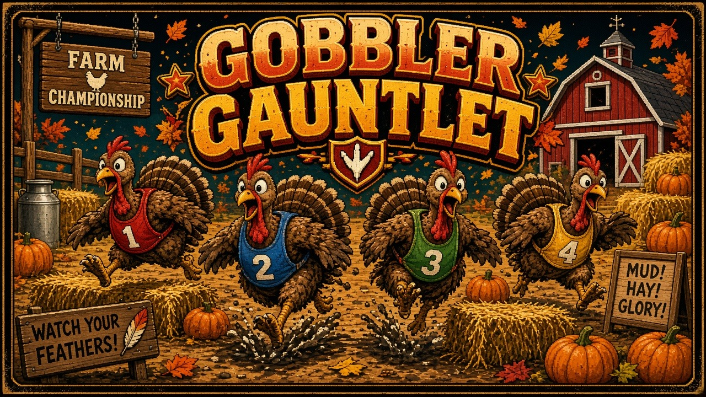

# Gobbler Gauntlet

Four turkeys, one dirt track, and a barn at the end. Gobbler Gauntlet is a local party race: an auto-scrolling farm course of hay, fences, mud, crossing tractors, and corn, played on a single shared screen. Jump the obstacles, flap-dash your rivals sideways, and stay ahead of the camera. Four races make a match.

## Launch

The game is plain HTML, canvas, and JavaScript. A tiny Python server hosts it and opens your browser. The default port is **8814**; if that port is taken, the server moves to the next free one.

| System | One-click |
| --- | --- |
| macOS | Double-click `launch-mac.command` |
| Windows | Double-click `launch-windows.bat` |
| Linux | `./launch-linux.sh` |

Or from a terminal, in this folder:

```bash
python3 server.py
```

Python 3 is required. If it is missing, the launcher says so and points you at python.org. No install step, no network, and no build.

## Controls

Everyone plays on one keyboard. A gamepad in slots 0–3 takes over that player (left stick or D-pad to move, A to jump, B to flap-dash, Start to pause) and shows a pad icon on the HUD. Unplug it and the keyboard binding comes back.

| Player | Move | Jump | Flap-dash |
| --- | --- | --- | --- |
| P1 Red | W A S D | F | G |
| P2 Blue | Arrow keys | / | . |
| P3 Green | I J K L | ; | ' |
| P4 Gold | Numpad 8 4 5 6 | Numpad 0 | Numpad Enter |

Esc or Start pauses. M mutes. On the join screen, each player's jump key joins and the dash key toggles that slot between bot and off. Enter starts the race. Controls can be remapped in Settings and are saved in localStorage.

Up sprints, down brakes, and left/right change lanes. Doing nothing still cruises, but the camera will eat a turkey that stalls.

## Rules

The course is a seeded farm with four lanes that sometimes pinch into two or three. Hay bales and fences have to be jumped. Mud slows you down. A tractor stuns whoever it hits. Corn is a short speed boost. Flap-dash is a burst with a 3 second cooldown, and it knocks a rival sideways.

The camera scrolls on its own and keeps the leader in view. Drop behind the bottom edge and you are out of that race. First turkey through the barn takes the race; the rest score by finish order. A clean race lands around 60–90 seconds.

| Finish | Points |
| --- | --- |
| 1st | 5 |
| 2nd | 3 |
| 3rd | 2 |
| 4th | 1 |
| Eliminated | 0 |

A match is 4 races (change that in Settings, from 1 to 8). Each race rolls a new course from the match seed. Most points wins. A points tie goes to whoever won more races; a remaining tie is a shared win.

Any empty slot can be a bot, so one person can race three turkeys, or you can watch four bots stampede. Bots sprint, hop, dodge tractors, and dash when the camera gets close.

## arcade.json

`arcade.json` is the arcade-cabinet manifest: name, id `gobblergauntlet`, cover, icon, the three launchers plus `index.html`, 4 players, minimum 1, keyboard and gamepad, version 1.0.0, and port 8814.

## Tests

```bash
node --test tests/
python3 tests/server_smoke.py
```

Node's built-in test runner covers movement and collision, scoring, elimination, corn and flap-dash, tractor stuns, seeded courses, keyboard and gamepad mapping, saved settings, and `arcade.json`. The Python smoke test checks that `server.py` serves the game and steps off a busy port. GitHub Actions runs both.

## License

MIT. See [LICENSE](LICENSE).
